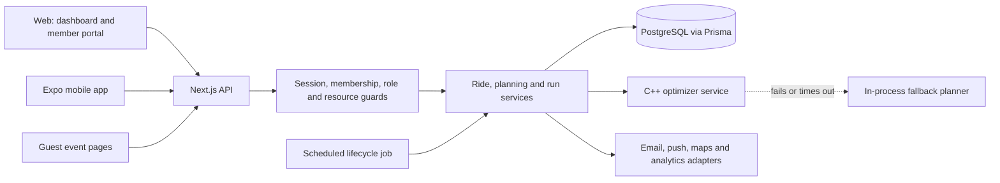

# RideSmart: Technical Case Study

RideSmart coordinates volunteer rides for churches. A coordinator posts a ride, members say whether they need a seat or can offer one, a C++ optimizer drafts pickup groups, the coordinator adjusts and sends the plan, and drivers run their pickups live while riders see when they will be collected.

**Live product:** [ridesmartapp.ca](https://ridesmartapp.ca)

> The production source code is private. This repository explains how RideSmart is built and why: its architecture, data model, concurrency strategy, optimizer, testing and the problems found in real use. It contains no application code, credentials, configuration or user data.

## At a glance (November 2026)

| | |
| --- | --- |
| **Status** | In a free founding pilot with church congregations, running real Sunday and midweek rides |
| **Built by** | One engineer: product, web, API, mobile, database, optimizer, testing and CI |
| **Clients** | Next.js coordinator dashboard and member portal; Expo mobile app (Android tested on a phone, iOS not yet) |
| **API** | 116 route modules exposing 132 HTTP handlers |
| **Data** | 31 PostgreSQL tables modelled in Prisma |
| **Automated tests** | 2,465 Jest tests (1,996 web, 469 mobile), Playwright journeys against a real Postgres in CI, and C++ checks built into the optimizer image |
| **History** | 400+ commits since April 2026; 96 written decision records |

## The problem

Church transportation usually runs on a group chat, a spreadsheet and one tired coordinator. Nobody is sure who still needs a seat, which drivers have room, whether the plan reached everyone, or what changed after someone cancelled on Saturday night.

RideSmart gives the coordinator one place to collect answers, build and send a plan, and watch the ride happen. Members get a short reply form and a clear message: who is picking them up, and when.

## What it does

**Coordinators**
- Post one-off or weekly rides, with an audience, a reply deadline and an optional ride home
- Draft a plan with the optimizer, compare suggestions, then drag people between cars on a map
- Send the plan by email, in-app notice and push; export it as a PDF, per-driver sheets, CSV or chat text
- Approve members and drivers, pause drivers, add guests, and watch a ride live on the day

**Members and drivers**
- Answer a ride (and its ride home) in one form, with saved or one-time pickup addresses
- Offer seats, see their car, driver and pickup time, and tell the driver "I'm ready"
- Drivers run their pickups stop by stop: road-following route, Picked up / Couldn't pick up with undo, and riders told their time when the run starts

**Guests**
- People without an account can request a seat through a public event link, verified by a single-use email link

## Architecture

One server is the authority for every client. The optimizer proposes; only the API commits, and only after re-checking the plan against current data inside a per-ride lock.

## Engineering highlights

- **Correct under concurrency.** Every write that seats, moves or removes a rider takes one per-ride PostgreSQL advisory lock and re-reads the ride inside it. Slow work (optimization, routing, email) stays outside the lock. Race tests interleave real route handlers and include lock-disabled controls to prove they can catch the race. [Read more](docs/engineering-notes.md#1-two-coordinators-one-ride)
- **Automation decides the same way people do.** The scheduled job that closes, plans and finalizes rides uses the same validator and the same unassigned-rider count as the coordinator's buttons, so the two paths cannot disagree.
- **An optimizer that is useful but never required.** A standalone C++23 service ranks candidate plans. If it is off, slow, unreachable or returns something malformed, the API validates the response, falls back to a simpler planner, and logs which path was used and why.
- **Round trips with no new tables.** A ride home is a second ride linked to the same event, so each direction keeps its own answers, cars and finalization. Return rides are planned in reverse: church first, then drop-offs.
- **Built from pilot feedback.** Many recent changes come from watching real use: emailed invitations because web members never saw in-app notices, a sign-in page that ad blockers hid, and time zone data that lagged a provincial law. [Read the stories](docs/engineering-notes.md)

## Technology

| Layer | Technology |
| --- | --- |
| Web and API | Next.js 16, React 19, TypeScript, Zod, Auth.js |
| Mobile | Expo 54, React Native 0.81, Expo Router, Reanimated, Gesture Handler |
| Data | PostgreSQL, Prisma 7 |
| Optimization | C++23, standard-library threads, JSON over HTTP, shipped as a Linux container |
| Messaging | Transactional email, Expo push with Firebase Cloud Messaging, in-app notices |
| Testing and CI | Jest, Testing Library, axe, Playwright, GitHub Actions with a Postgres service container |
| Workspace | pnpm workspaces and Turborepo |

## Read further

| Document | What it covers |
| --- | --- |
| [Architecture](docs/architecture.md) | Components, ride lifecycle, request flows and design decisions |
| [API and data design](docs/api-and-data-design.md) | Resource areas, layered authorization, the relational model and write paths |
| [Optimization service](docs/optimization-service.md) | The C++ planner, where concurrency is used, hardening and fallback |
| [Security, validation and testing](docs/security-validation-and-testing.md) | Threats and controls, validation layers, test strategy and CI |
| [Engineering notes](docs/engineering-notes.md) | Eight specific problems and how they were solved |
| [Product and pilot](docs/product-and-pilot.md) | Users, scope decisions, what the pilot changed, and how the work is run |

## About the numbers

Counts come from the private repository on 4 November 2026. Route modules and HTTP handlers are counted separately because one route file can export several methods. Test totals are from full local Jest runs on that date, all passing.

## Source code

RideSmart's source code remains private. This repository is documentation only: no application source, Git history, credentials, environment files, database exports, real user data, internal URLs or deployment configuration. I am happy to walk through the code in an interview.
