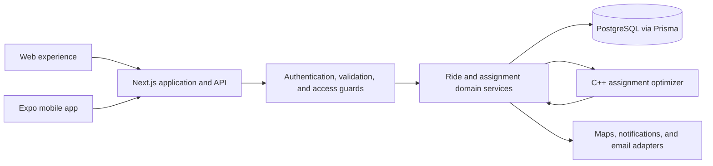

# RideSmart: Technical Case Study

RideSmart is a church-first ride-coordination platform for collecting member responses, matching riders with approved volunteer drivers, planning routes, and supporting day-of pickup workflows.

**Live product and visual demonstration:** [https://ridesmartapp.ca](https://ridesmartapp.ca)

> RideSmart's production source code is maintained in a private repository. This public case study documents the system's architecture, engineering decisions, and implementation approach without exposing proprietary code or sensitive configuration.

## Technical snapshot: September 2026

These counts reflect the private repository in September 2026:

- **62 API route modules** exposing **84 HTTP method handlers**
- **23 PostgreSQL-backed Prisma models**

The optimizer's production-oriented candidate-pool target is approximately 200 plans. Its ranking path switches from sequential to multithreaded evaluation at 4,096 candidates, so the normal pool intentionally remains sequential.

## The problem

Volunteer transportation is often coordinated through spreadsheets, chats, and phone calls. That makes it difficult to know who needs a ride, which approved drivers have capacity, whether everyone is assigned, and what changed after responses were updated.

RideSmart gives an organization control over membership, driver approval, ride publication, assignment review, and finalization while giving members a focused RSVP and pickup experience.

## Major capabilities

- Membership, join policies, admin approval, and per-organization driver approval
- One-off and recurring rides with audiences, deadlines, RSVP, and seat offers
- Saved or ride-specific pickup locations, reminders, and notifications
- Ranked pickup-group suggestions with explicit unassigned-rider handling
- Admin review, manual adjustment, finalization, and driver-out reassignment
- Driver itinerary, pickup/no-show tracking, route handoff, and completion

## My engineering contributions

I designed and implemented RideSmart across its web, API, mobile, data, and optimization layers. My work includes the monorepo and shared TypeScript contracts; the Next.js application and API; the Expo member and driver application; the PostgreSQL/Prisma data model; authentication, authorization, and validation boundaries; the C++ optimizer integration; concurrency-safe assignment writes; and automated testing across the platform.

Automated coverage spans the web application, mobile application, API boundaries, accessibility behavior, and end-to-end workflows.

## Verified technology stack

| Layer | Technology |
| --- | --- |
| Web and API | Next.js 16, React 19, TypeScript, Zod, Auth.js/NextAuth |
| Mobile | Expo 54, React Native 0.81, Expo Router, TypeScript |
| Data | PostgreSQL, Prisma 7 |
| Optimization | C++23, standard-library threading, JSON over HTTP |
| Testing | Jest, Testing Library, Playwright, TypeScript, ESLint |
| Workspace | pnpm workspaces and Turborepo |

## Architecture

The optimizer improves plan quality but is not a single point of failure. If it is disabled, times out, or returns an invalid result, the API can build a simpler capacity-based plan.

## Technical highlights

- **Layered access control:** session, membership, role/capability, and resource checks are separate server-side boundaries.
- **Concurrency-aware writes:** planning happens outside the critical section; the plan is revalidated against locked, current state before persistence.
- **Stable historical data:** ride-specific pickup details are snapshotted so later profile edits do not rewrite a coordinated trip.
- **Resilient optimization:** the C++ service returns ranked alternatives and unassigned riders while the API retains a deterministic fallback.

## Selected tradeoffs

| Decision | Tradeoff |
| --- | --- |
| Plan outside the database lock, then revalidate | A stale plan may be rejected, but slow optimization does not block other ride writes |
| Keep the optimizer optional | Fallback plans are less geographically sophisticated, but assignment remains available |
| Enforce cross-assignment rider uniqueness in serialized service logic | The transaction boundary and race tests become essential because one ordinary database constraint cannot express the full rule |

## Explore the system

- [Architecture and request flows](docs/architecture.md)
- [API and data design](docs/api-and-data-design.md)
- [C++ optimization service](docs/optimization-service.md)
- [Security, validation, and testing](docs/security-validation-and-testing.md)

## Source-code statement

RideSmart's production source code remains private. This documentation-only repository contains no application source, Git history, credentials, environment files, database exports, real user data, internal URLs, or deployment configuration.
