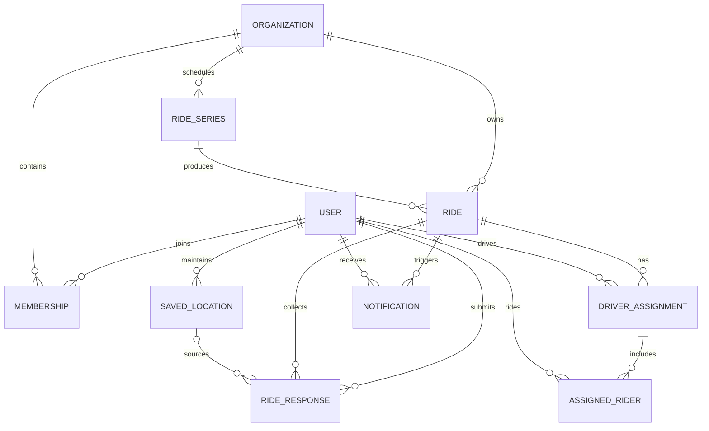

# API and data design

RideSmart's API is implemented with Next.js route handlers and TypeScript domain services. The public case study groups the surface by responsibility rather than publishing a complete route inventory.

## Verified API scope

The technical snapshot defined in the root README contained:

- **62 API route modules**
- **84 exported HTTP method handlers**

This means the older résumé phrase **"42-endpoint REST API" is no longer current**. Route files and HTTP handlers are different counting units, so the case study states both and avoids calling either one a permanent endpoint count.

## Major resource categories

| Category | Representative responsibilities |
| --- | --- |
| Authentication and account | Registration, sessions, sign-in methods, contact verification, profile settings |
| Organizations and membership | Discovery, join policies, join codes, requests, member roles, driver approval, organization settings |
| Rides and recurring series | Draft/publish lifecycle, audience, scheduling, recurrence, response deadlines |
| Responses and locations | RSVP status, seat offers, saved locations, ride-specific pickup snapshots |
| Planning and assignments | Preview, ranked plans, plan application, manual adjustment, finalization, reassignment |
| Driver operations | Assignment review, itinerary, route progress, pickup/no-show outcomes |
| Notifications and preferences | In-app notifications, push-token lifecycle, reminders, per-user and per-organization preferences |
| Feedback and support | Post-ride feedback, problem reports, contact requests, privacy-aware analytics events |

The exact URL list is intentionally omitted. It would add little architectural value and would become stale faster than the resource model.

## Request validation

Zod schemas parse many state-changing request bodies and normalize the resulting TypeScript types before domain logic runs. Validation covers shapes such as:

- authentication and account input;
- organization membership transitions;
- ride creation and updates;
- response and seat-capacity input;
- proposed assignment plans;
- navigation/pickup updates; and
- settings, support, and analytics payloads.

Validation is not presented as a substitute for authorization or business rules. A structurally valid request may still be rejected because the user is not an active member, lacks the required role, the ride is in the wrong state, a driver is not approved, or the proposed plan is stale.

## Authentication and authorization boundaries

RideSmart separates several concepts that are often collapsed into one role field:

1. **Authentication:** establish a current user session and confirm that the account still exists.
2. **Platform role:** reserve platform-wide administration from organization roles.
3. **Organization membership:** require a membership record and, for operational actions, an active status.
4. **Organization role:** distinguish member and administrator permissions; the organization owner is also treated as an administrator.
5. **Driver capability:** track whether a member is approved to offer seats. This is orthogonal to admin/member role.
6. **Resource relationship:** verify ride response, assigned-driver, audience, or ownership relationships when the action requires them.

This layered model supports least-privilege decisions. For example, being an organization admin does not automatically make someone an approved driver, and being an approved driver does not grant organization administration.

## High-level relational model

The snapshot contained 23 PostgreSQL-backed Prisma models. The diagram below shows only the relationships central to ride coordination.

## Notable schema decisions

### Membership is a durable relationship

Each user/organization pair has one membership record whose status changes over time. This makes the current state easy to query and prevents duplicate memberships.

**Tradeoff:** discrete join/leave cycles are not separate rows. A future audit-log requirement would add an event table rather than overloading the membership record.

### Driver approval is not a role

Driver status lives on the organization membership. A member or administrator may independently be approved, pending, revoked, or not participating as a driver.

**Why:** authorization and operational capability answer different questions. Keeping them separate prevents role escalation just to let someone drive.

### Ride-specific pickup information is snapshotted

A response may reference a saved location, but it also stores the pickup values used for that ride.

**Why:** a member may leave from a different place for one ride, and later profile edits must not rewrite an assignment already given to a driver.

### Recurring rides remain independent

Each generated occurrence is a normal ride row linked to its series.

**Why:** responses, assignments, cancellation, and completion belong to an occurrence. Series operations can still target future occurrences without treating them as one shared ride.

### Assignment history is preserved

Driver assignments use explicit statuses. Reassignment can cancel an old record and create a replacement instead of rewriting operational history.

### Cross-assignment uniqueness is enforced in the service transaction

The schema prevents the same rider from being duplicated inside one driver assignment. Preventing a rider from appearing in two active assignments for the same ride depends on the statuses of multiple records, so the API serializes assignment mutations by ride and checks the invariant before writing.

**Tradeoff:** the database cannot communicate this rule through one ordinary uniqueness constraint. Correctness therefore depends on one shared transaction boundary and dedicated concurrency tests.

## Write-path pattern

Safety-critical writes follow the same shape:

1. Authenticate the user.
2. Resolve the target resource without returning deleted records.
3. Enforce membership, role, capability, and resource-specific access.
4. Parse the request with a typed schema where input is accepted.
5. Perform slow planning or external work outside the lock.
6. Enter a short transaction scoped to one ride.
7. Re-read status, responses, assignments, and capacity under that transaction.
8. Reject stale or invalid state; otherwise write atomically.
9. Build notifications or response views after the protected decision.

## Data minimization

The optimizer receives only one ride's planning data: anonymous internal identifiers, coordinates required for routing, seat capacity, and the destination. It does not receive credentials, membership administration data, notification preferences, or direct database access.
