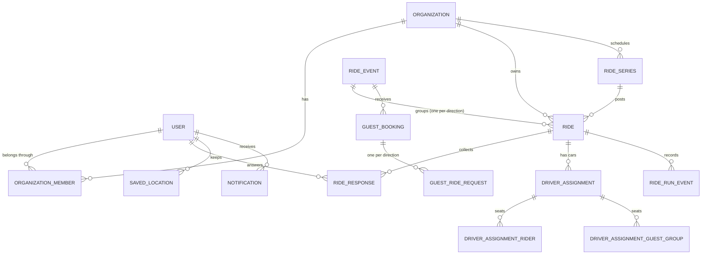

# API and data design

The API is built from Next.js route handlers backed by TypeScript domain services. This document groups it by responsibility rather than listing URLs, which would go stale faster than the model behind them.

## Scope

On 4 November 2026 the private repository had **116 API route modules** exporting **132 HTTP method handlers**, and **31 Prisma models** backed by PostgreSQL. Route files and handlers are counted separately because one file can export several methods.

## Resource areas

| Area | Responsibilities |
| --- | --- |
| Accounts and sign-in | Email and password, email sign-in links, Google sign-in (web and native), password reset and change, signing out other devices, contact verification |
| Organizations and membership | Discovery, join codes and policies, join requests, roles, driver approval and pausing, invitations for new emails, settings and time zone |
| Rides, events and series | Draft, publish, close, reopen, cancel; ride homes linked to an event; weekly series that post their next ride |
| Answers and pickups | Going or not, seat offers, late seat offers, saved and one-time pickup addresses, coordinators answering for a member |
| Planning and assignments | Preview ranked plans, apply, move, remove, reorder, change a driver's seats on one ride, make a rider a driver, finalize, driver-out reassignment |
| Pickup run | Start run, per-rider estimated times, "I'm ready", picked up / couldn't pick up with undo, run history for the driver |
| Exports | Plan PDF, per-driver sheets, CSV, group-chat text (coordinators only) |
| Guests | Public event pages, seat requests, single-use verification links, booking status, edit and cancel |
| Notifications | In-app notices, push token lifecycle, email delivery, per-group preferences |
| Lifecycle job | Posting recurring rides, closing replies, automatic planning and finalization, starting and completing rides |
| Feedback, support and analytics | Post-ride feedback, problem reports, contact requests, schema-checked product events |

## Authorization is layered

RideSmart keeps apart several ideas that are often folded into one role column:

1. **Authentication:** a current session for an account that still exists, invalidated when the password changes.
2. **Platform role:** platform administration, separate from any organization.
3. **Membership:** a membership record that is active; banned or removed members cannot rejoin through a join route.
4. **Organization role:** member or administrator (the owner is treated as an administrator).
5. **Driver capability:** whether this member may offer seats in this organization: none, pending, approved, rejected or paused. Independent of role.
6. **Resource relationship:** the member's own answer, the driver's own car, a rider's own car, the ride's audience.

Being an administrator does not make someone a driver, and being a driver grants no administration.

### Who sees what

Visibility rules are enforced on the server, not by hiding fields in the UI:

- Draft rides are invisible to members in lists, search, counts and direct links.
- Member contact details and addresses are hidden from other members. Riders see only the names of the people in their own car, not the whole plan.
- A driver sees the pickups of the riders in their own car, for the rides they drive.
- Plan exports and sharing are coordinator-only.

## Validation

Zod schemas parse state-changing request bodies before any domain logic runs: account input, membership changes, ride creation and edits, answers and seat counts, proposed plans, pickup updates, guest requests, settings and analytics events. Responses from the optimizer and data the mobile app reads back from storage are validated the same way.

Shape validation is never treated as permission. A well-formed request is still refused if the member is inactive, the ride is in the wrong state, the driver is not approved, or the plan is stale.

## Relational model

The diagram shows the relationships at the heart of ride coordination; account, settings, notification-delivery and guest-verification tables are omitted.

## Schema decisions

### Membership is one durable row

Each user and organization pair has one membership row whose status changes over time. Current state is a single lookup and duplicates are impossible. If an audit trail of join and leave cycles is needed later, it will be an event table, not extra rows here.

### Driver approval is not a role

Driver status lives on the membership. Approving someone to drive never requires granting them administration, and pausing a driver does not touch their membership.

### Pickups are snapshotted per ride

An answer may point to a saved location but also stores the pickup used for that ride. A member can leave from somewhere else just once, and editing a saved address later does not move a pickup a driver has already been given. Coordinates are only stored when they belong to the text: editing the address clears them, and the server geocodes strictly, refusing partial or ambiguous matches rather than guessing.

### A ride home is a second ride, not a new shape

A `RideEvent` groups an outbound ride and, optionally, a return ride, with a uniqueness rule of one ride per direction per event. Each direction keeps its own answers, cars and finalization. The two-way feature for members needed **no new tables or columns**: the work was behaviour (one form, one deadline, reverse planning, direction labels), which the design record set out before any code was written.

### Recurring rides are ordinary rides

A series posts real ride rows, each with its own answers, cars and lifecycle. Dates step from the first occurrence in the organization's time zone, so a 9:00 service stays at 9:00 through daylight saving changes.

### Guests are seat-demand groups

A guest booking can bring several people. Planning treats each group as one unit with a seat demand that is never split across cars. Members have a seat demand of one, so members and guests go through the same capacity validator.

### Run events are append-only and idempotent

Pickup outcomes, "running late" and alerts are rows in a run-event log. Each client-generated event carries a unique ID, so an action queued offline on a phone and replayed later is recorded once, with the time it actually happened. Free-text reasons are cleared 90 days after the ride.

### Assignment history is kept

Cars have explicit statuses. Reassigning a driver cancels the old car and creates a new one instead of rewriting history.

### Cross-assignment uniqueness lives in the transaction

The schema prevents a rider appearing twice in one car. Preventing a rider appearing in two active cars on the same ride depends on the status of several rows, so the API serializes every assignment change for a ride and checks the rule before writing. The cost is that correctness depends on one shared transaction boundary, which is why the race tests exist.

## The write path

Every write that can seat, move or remove someone follows the same shape:

1. Authenticate.
2. Load the target, excluding deleted records.
3. Check membership, role, driver capability and the resource relationship.
4. Parse input with a typed schema.
5. Do slow work outside the lock: optimization, route lookups, geocoding.
6. Open a short transaction and take the per-ride advisory lock. If the lock is not available within 8 seconds, return a clear "this ride is busy" response rather than an error.
7. Re-read ride status, answers, cars and seat counts inside the transaction.
8. Refuse stale or invalid state; otherwise write, with status changes conditional on the status they were decided from.
9. After commit, build the response and send notifications.

## Data minimization

The optimizer receives one ride's planning data only: identifiers, the coordinates needed for routing, seat counts and the destination. Display names are optional in its contract and play no part in ranking. It never receives credentials, permissions or database access. Product analytics carry enums, booleans and counts only, and a contract test fails if the mobile and server event definitions drift apart.
