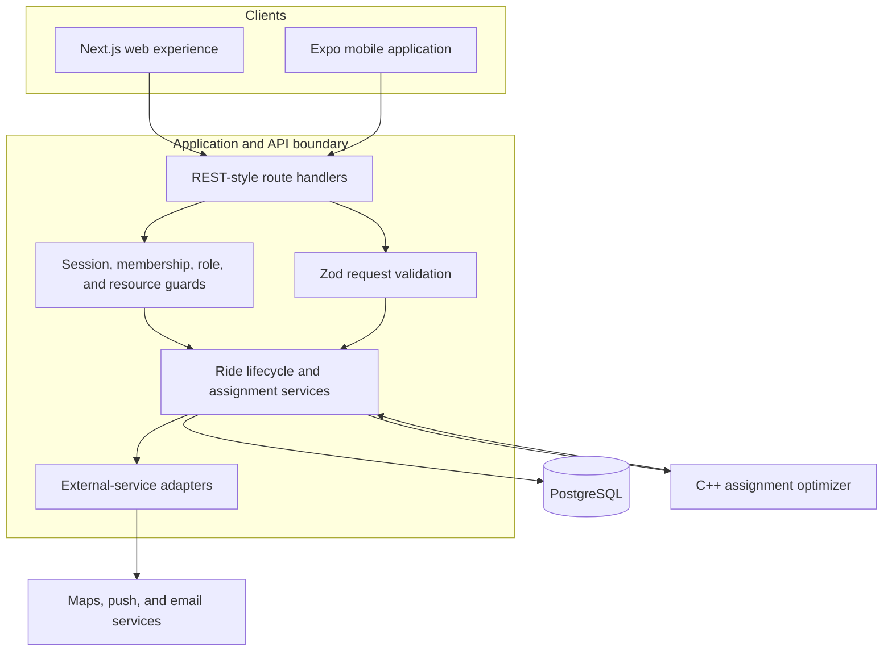
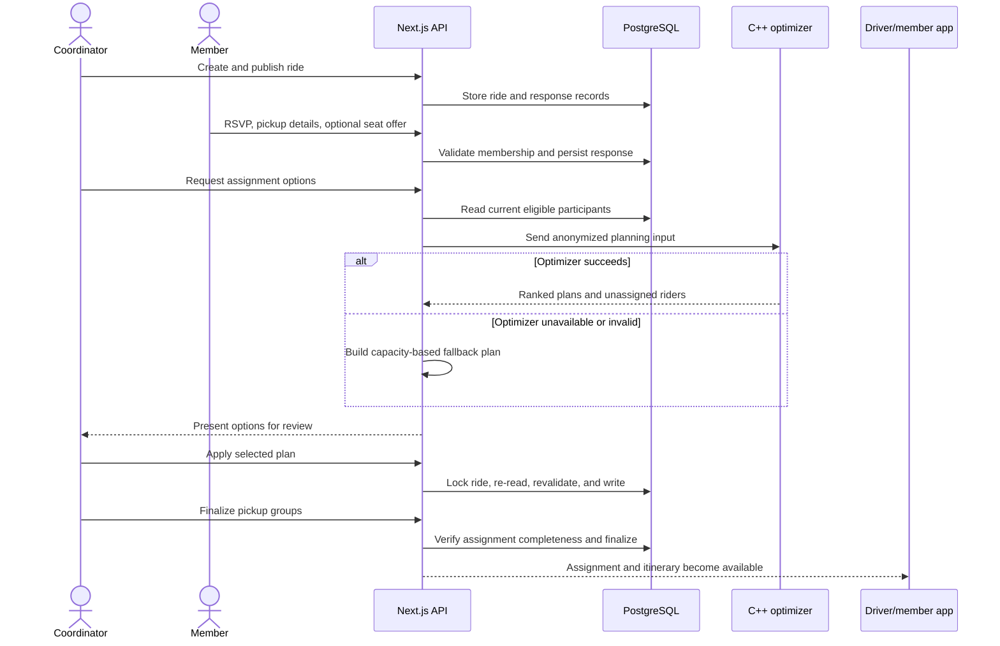
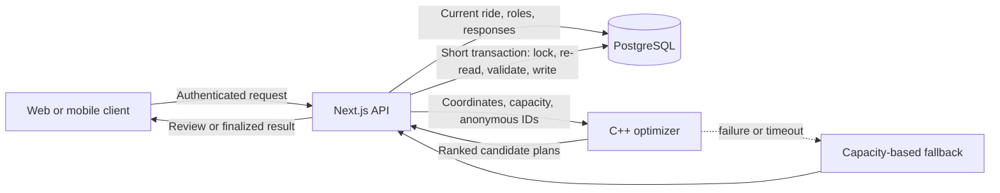

# Architecture

RideSmart is organized around one authoritative application/API layer, a relational database, native and web clients, and an optional optimization service. The production repository is private; the diagrams below deliberately omit provider-specific hostnames, credentials, and deployment topology.

## System overview

### Responsibility boundaries

| Component | Owns | Does not own |
| --- | --- | --- |
| Web and mobile clients | Presentation, local interaction state, typed API calls | Final authorization or assignment integrity |
| Next.js API | Authentication, request validation, authorization, lifecycle rules, persistence orchestration | Route-quality computation internals |
| PostgreSQL/Prisma | Relational data, local constraints, transactions, indexes | Cross-record business decisions without service context |
| C++ optimizer | Candidate generation, route-aware ranking, ranked plan output | Authentication, database writes, or finalization |
| External adapters | Maps, notification, and email integration boundaries | Core ride state |

## Typical ride-coordination flow

The important boundary is between **planning** and **committing**. Planning may use stale data by the time it finishes. The API therefore treats every generated plan as a proposal and checks it again against locked, current state before persistence.

## Web, API, database, and optimizer relationship

Only the API can commit assignment state. The optimizer is deliberately database-agnostic and receives the minimum planning data needed for one request.

## Key design decisions

### One server authority across clients

Web and mobile use the same API contracts and lifecycle rules. This avoids duplicating safety-critical decisions such as driver eligibility, remaining capacity, and finalization completeness in presentation code.

### Short, scoped serialization

Planning and external calls happen before the per-ride transaction. The transaction contains only the current-state reads, semantic revalidation, and writes that must be atomic.

### Optional optimization

The optimized path improves plan quality, but operational availability does not depend on a separate service. A simpler fallback is explicitly identified to the review flow.

### Independent recurring occurrences

A recurring series generates ordinary ride records. Each occurrence can have its own responses, assignments, and lifecycle while remaining linked to the series for future edits.

### Historical snapshots where user-edited data matters

Ride-specific pickup details are stored with the response. Editing or deleting a saved location later does not silently change an already-coordinated ride.

## Known boundaries

- Hosted service health, provider configuration, and production load characteristics are not documented here because they require authorized live-environment evidence.
- The current optimizer's normal candidate pool is below its parallel-search threshold; multithreading is reserved for larger pools.
- Some cross-record assignment invariants are protected in the service transaction rather than by a single database constraint.
- This case study describes the current one-way ride lifecycle. A broader two-way journey model remains a separate product and data-model decision.
