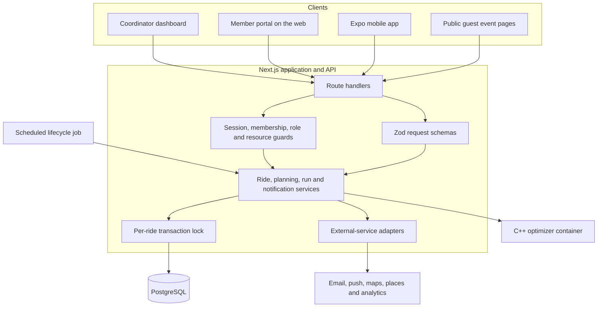
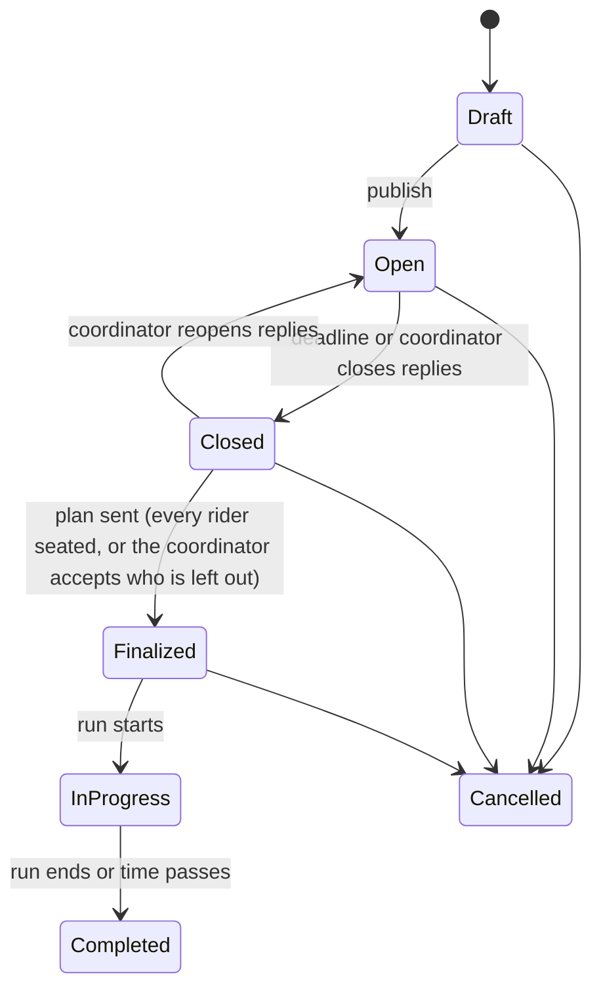
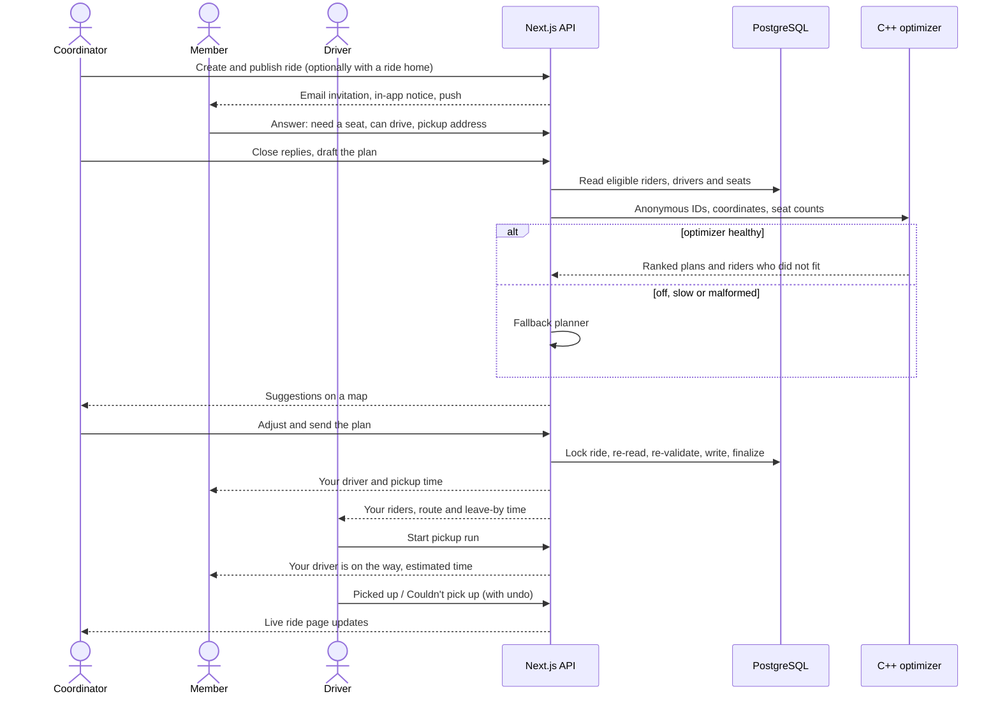
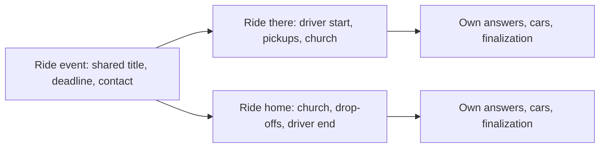

# Architecture

RideSmart has one authoritative application and API layer, one relational database, three kinds of client (coordinator dashboard, member portal and mobile app, plus public guest pages), a scheduled lifecycle job, and an optional optimization service. Provider hostnames, credentials and deployment topology are left out on purpose.

## System overview

### Who owns what

| Component | Owns | Does not own |
| --- | --- | --- |
| Web and mobile clients | Presentation, drafts, local interaction state, typed API calls, queued offline actions | Authorization or any final decision about seats |
| Next.js API | Authentication, validation, authorization, lifecycle rules, persistence, notifications | Route-quality search internals |
| Scheduled job | Posting the next recurring ride, closing replies, automatic planning, starting and completing rides | Anything the coordinator buttons cannot also do |
| PostgreSQL / Prisma | Relational data, local constraints, transactions, advisory locks | Rules that span several records without service context |
| C++ optimizer | Candidate generation, route-aware ranking, ranked plan output | Authentication, database access or committing a plan |
| Adapters | Email, push, maps, places autocomplete, analytics | Core ride state |

## Ride lifecycle

Every status write is conditional on the status it was decided from and on the ride not being deleted. A cancel and an automatic close that arrive together cannot both win, and the general update endpoint can only publish, close or cancel: finalizing, starting and completing each go through their own endpoint with their own checks.

## A ride from start to finish

The key boundary is between **planning** and **committing**. A plan can go stale while it is being built or reviewed, so the API treats every plan as a proposal and checks it again against locked, current state before writing.

## Round trips

An event can have a ride there and a ride home. Each direction is an ordinary ride linked to the event, with a uniqueness rule allowing at most one of each direction per event.

Members answer both directions in one form (ride there selected by default, ride home an explicit opt-in), receive one invitation and one reminder per event, and see the pair as one entry in every list. Coordinators finalize each direction on its own, so a late change to the ride home does not reopen a ride that has already happened.

## Live pickup run

When a driver starts a run, the API computes each rider's estimated pickup time from the same route legs the driver's navigation uses, and tells each rider. Pickups are recorded as explicit, idempotent outcomes with an undo window. The coordinator's live ride page shows each car's progress. On mobile, run actions taken without signal are queued and replayed in order.

## Key design decisions

**One server authority across clients.** Web, mobile and guest pages share the same API and lifecycle rules. Driver eligibility, remaining seats and finalization completeness are decided once, on the server.

**Short, scoped serialization.** Optimization, route lookups, review building and notifications happen outside the per-ride transaction. The transaction contains only the reads, re-validation and writes that must be atomic.

**Automation through the same door.** The scheduled job plans with the same validator coordinators use and finalizes behind the same unassigned-rider count. A ride it cannot finalize gets one retry, then one alert to a coordinator rather than repeated attempts.

**Optional optimization.** Plan quality improves with the optimizer, but rides can be planned without it. The plan source and the fallback reason are recorded.

**Snapshots where user-edited data matters.** A rider's pickup for a ride is stored with their answer, so editing a saved address later does not move a pickup a driver has already been given.

**Times in the church's zone.** Ride times, "on the day of the ride" checks and recurring schedules use the organization's time zone, not the server's or the phone's.

## Known boundaries

- Hosted uptime, monitoring and backup restore are outside what this document can show.
- The pilot runs on the web first; physical-device proof exists for Android, not yet for iOS.
- Some cross-record rules (a rider in at most one active car per ride) are enforced by serialized service code rather than one database constraint. See [API and data design](api-and-data-design.md#cross-assignment-uniqueness-lives-in-the-transaction).
- Return rides are modelled and built for members; the first pilot church started with one-way rides by choice.
