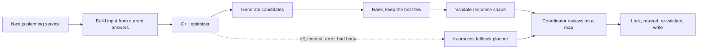

# Optimization service

RideSmart includes a standalone C++23 service that proposes which riders go in which car, and in what pickup order. It improves plan quality while staying outside authentication, the database and the decision to commit a plan.

## The question it answers

Given the approved drivers on a ride, their seats and starting points, the riders and guest groups who need a seat, and the destination: which groupings give a sensible balance of route length, fairness between drivers and total distance driven?

It returns a recommended plan and a few alternatives. The coordinator sees them as suggestions on a map, can change anything, and the API re-validates whatever is finally sent against current data.

## Contract

**Input** for one ride:
- a ride identifier and destination coordinate;
- drivers: identifier, start coordinate and available seats;
- riders and guest groups: identifier, pickup coordinate and seat demand (1 for a member, the group size for guests).

**Output:**
- ranked candidate plans, each with cars, riders and pickup order;
- riders who could not be placed, with a reason;
- route-balance statistics used to compare plans.

The service never receives credentials, permissions or database access. Display names are optional and take no part in ranking.

## Where it sits

The C++ core (candidate generator, search engine, distance engine and models) knows nothing about HTTP or JSON. One server file is the only translation layer, which keeps the algorithm testable on its own.

## Planning approach

1. Precompute the pairwise distances one request needs.
2. Generate feasible groupings with several deterministic and randomized heuristics.
3. Explore around those seeds with route-aware insertion and local improvement.
4. Drop duplicate plans.
5. Score each plan on a blend of the longest driver route, the spread between drivers and the total fleet distance.
6. Return the best plan and a few alternatives.

Guest groups are placed whole: a family of four is never split across two cars, and a car only takes a group if it has seats for all of them. The same seat-demand rule is enforced again by the API's validator, so neither side has to trust the other.

For a ride home, the API orders each car's stops in reverse: from the church to each drop-off and then to the driver's own end point.

The full search strategy and tuning values stay private.

## Where concurrency is used, and where it is not

Scoring candidates is embarrassingly parallel: each plan's score is independent. For large pools the search engine splits candidates into disjoint ranges, ranks each range on its own `std::thread`, joins the workers, and merges their local winners on the calling thread. Worker count is bounded by the hardware and the pool size.

A ride's normal pool is around 200 candidates. Below 4,096 candidates the engine stays sequential, because starting and joining threads would cost more than it saves. So multithreading is a scaling path for big pools, not something every request uses, and a benchmark checks that both paths pick the same winner.

**Shared state, and how each piece is protected:**

| State | Protection |
| --- | --- |
| Best plan across workers | None needed: each worker writes only its own local results over a disjoint range; the merge happens after join |
| Per-client rate-limit table | `std::mutex` with RAII `std::lock_guard`, released on every return path |
| Plan identifiers across concurrent requests | Atomic counter |

## Hardening

The service listens on all interfaces, so it is built to be safe when exposed:

- **Fails closed.** It refuses to start without a shared secret unless an explicit local-development switch is set. `POST /optimize` requires the secret header; `GET /health` stays open for uptime checks.
- **Bounded input.** Request body size, driver count and rider count are capped. Chunked bodies are refused. Coordinates must be finite and in range, seat counts within sensible limits, identifiers non-empty, bounded in length and unique. Each rule returns a specific status (400, 411, 413).
- **Rate limited.** Per-client limits return 429 with `Retry-After`.
- **Distrusted by its caller.** The API validates the optimizer's response with a schema before using it, then runs the chosen plan through the same capacity, eligibility and duplicate-rider checks as any hand-made plan.

## Build, test and ship

The service ships as a Linux container. The image build compiles with GCC 14 and runs the C++ test executables (request guards and seat demand); a failing test means no image. A GitHub Actions workflow builds that image on every change to the service and smoke-tests the running container's HTTP API. Third-party single headers for HTTP and JSON are vendored, so the build needs no package manager.

## Fallback

The API uses its in-process planner when the service is disabled, coordinates are missing, the request times out, the service is unreachable, returns an error, or returns a body that fails validation. The fallback favours availability and capacity over route quality. Each planning run logs one structured line saying which planner produced the plan and, for a fallback, why, and the coordinator's preview event records the same.

## Tradeoffs

- **Heuristic search** gives good, explainable options quickly but does not promise a global optimum.
- **Approximate distances** are fine for comparing plans; the driver's route map and live pickup times use road routes.
- **Thresholded parallelism** avoids thread overhead on normal rides at the cost of not speeding them up.
- **In-memory rate limiting** protects one process, not several replicas.
- **Human review stays in the loop.** The coordinator chooses and sends the plan, especially when someone is left without a seat.
