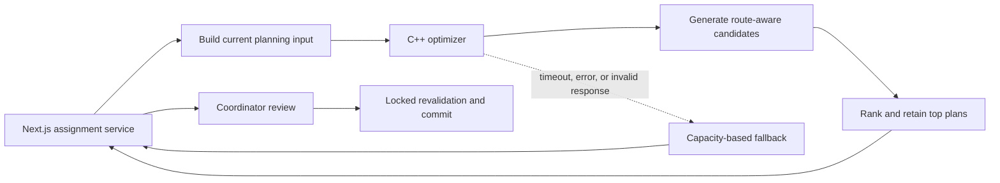

# Optimization service

RideSmart includes a standalone C++23 service that proposes driver/rider groupings for a ride. It improves plan quality while remaining isolated from authentication, database access, and final assignment authority.

## Purpose

The service helps a coordinator answer: given the available approved drivers, their seat capacities, rider pickup coordinates, and a destination, which pickup groups provide a reasonable balance between route length, fairness, and fleet efficiency?

It returns a recommendation plus alternatives. A coordinator can review the result, and the API validates the chosen plan against current application state before saving it.

## Inputs and outputs

The optimizer receives one request containing:

- an opaque ride identifier;
- a destination coordinate;
- opaque driver identifiers, starting coordinates, and available rider seats; and
- opaque rider identifiers and pickup coordinates.

It returns:

- ranked candidate plans;
- driver-to-rider groupings with pickup order;
- riders who could not be placed; and
- high-level route-balance statistics used to compare plans.

Names are optional for the service contract and are not needed for the ranking decision. The service does not receive account credentials, organization permissions, or database access.

## Service relationship

## Planning approach

The implementation deliberately separates candidate generation from ranking:

1. A distance matrix precomputes the pairwise distances needed during one optimization request.
2. Multiple deterministic and randomized heuristics generate feasible driver/rider groupings.
3. Route-aware insertion and local improvement explore alternatives around those seeds.
4. Duplicate candidate assignments are removed.
5. Each plan is scored using a blend of the longest driver route, spread between used drivers, and total fleet distance.
6. The best plan and a small number of alternatives are returned for review.

This description is intentionally high-level. The private implementation, full search strategy, and tuning values are not reproduced here.

## Why concurrency was used

Ranking a very large candidate pool is embarrassingly parallel: each candidate's score can be evaluated independently. The large-pool path therefore divides candidates into disjoint chunks, ranks each chunk on a worker thread, joins the workers, and performs one final merge over the local winners.

The number of workers is bounded by available hardware and the candidate count.

## Resume-safe summary

> Developed a standalone C++ optimization service with sequential and multithreaded ranking paths, using partitioned worker ranges and mutex-protected rate limiting.

The implementation details behind that statement are:

- The service is standalone and contains a `std::thread` ranking path.
- The current production-oriented pool target is approximately 200 candidates.
- The ranking code deliberately remains sequential below 4,096 candidates because thread creation and joining would cost more than the work saved.
- Multithreaded ranking is therefore implemented and benchmarked, but the normal pool currently takes the sequential path.

This distinction matters: the implementation supports multithreaded scaling without claiming that every request benefits from parallel execution.

## How shared state is protected

### Best-plan selection

Worker threads do not update one shared "best plan." Each thread operates on a distinct candidate range and writes only to its own local-top container. After all workers join, the calling thread merges those local results.

That structure avoids lock contention in the ranking hot path. Its safety depends on the chunk ranges remaining disjoint, a constraint called out in the private implementation.

### Service rate limiting

The HTTP boundary maintains a small shared in-memory rate-limit structure. That state is protected by `std::mutex` and an RAII `std::lock_guard`, so the lock is released automatically on every return path.

### Plan identifiers

An atomic counter is used when concurrent requests materialize candidate plans, avoiding a race over generated plan identifiers.

## Accuracy of the C++ claims

| Claim | Review result |
| --- | --- |
| Standalone C++ optimization service | Confirmed |
| Uses `std::thread` | Confirmed for large-pool ranking |
| Uses `std::mutex` and RAII locking | Confirmed at the HTTP rate-limit boundary |
| Mutex-protected best-solution selection | Inaccurate; best-plan ranking uses disjoint local work plus join-and-merge, not a shared mutex-protected winner |
| Multithreading is used on the normal ~200-plan path | Not accurate; that path is intentionally sequential |

## Failure and fallback behavior

The API treats optimization as optional. It switches to the simpler in-process plan when the service is disabled, required coordinates are unavailable, the request times out, the service is unreachable, a non-success response is returned, or the payload is malformed.

The fallback prioritizes availability and capacity rather than route quality. Regardless of source, the proposed plan still passes through the same eligibility, duplicate-rider, capacity, current-state, and finalization checks.

## Tradeoffs and limitations

- **Heuristic search:** it produces practical ranked options but does not claim a global optimum for every instance.
- **Approximate route model:** high-level geographic distance and pickup ordering are useful for comparison but are not a replacement for live traffic routing.
- **Thresholded parallelism:** avoids overhead on normal pools, but makes the multithreaded path primarily a scaling mechanism rather than an every-request speedup.
- **In-memory rate limiting:** protects one process but is not a distributed limit across multiple replicas.
- **Fallback quality:** preserves availability at the cost of geographic sophistication.
- **Human review:** the coordinator remains responsible for choosing and finalizing a plan, especially when riders remain unassigned.
