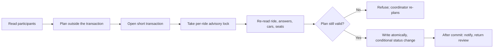

# Security, validation and testing

RideSmart holds people's home addresses, phone numbers and where they will be on a Sunday morning. The approach is to keep authority on the server, send as little data as possible across each boundary, and test hardest where stale or simultaneous requests could put the wrong person in the wrong car.

Secrets, provider identifiers, internal URLs and deployment configuration are left out of this document.

## Threats and controls

| Risk | Control |
| --- | --- |
| Unauthenticated access | Server-side session checks confirm the account still exists; changing a password ends other sessions |
| Reaching another organization's data | Active membership is checked before any organization resource is read |
| Privilege confusion | Platform role, organization role, ownership and driver capability are separate checks |
| Seeing too much | Draft rides hidden from members everywhere; member contact details hidden from other members; riders see only their own car; exports coordinator-only |
| Removed members coming back | Banned or removed members cannot rejoin through join codes or requests |
| Malformed input | Zod schemas parse request bodies, optimizer responses and data the mobile app reads back from storage |
| Password disclosure | Argon2id hashing; raw passwords are never stored |
| Guest link abuse | Single-use, hashed verification links; a booking-scoped guest session separate from member sign-in; generic public responses that do not reveal whether an email exists |
| Brute force and abuse | Database-backed rate limits on abuse-prone routes; a separate limit on the optimizer |
| Stale plans | Plans are re-read and re-validated inside the ride's transaction just before writing |
| Simultaneous changes | One per-ride advisory lock serializes every safety-critical write |
| Skipping lifecycle steps | The general update endpoint can only publish, close or cancel; finalizing, starting and completing have their own guarded endpoints |
| Optimizer exposure or failure | Fails closed without a shared secret, caps and validates input, has no database authority, and its output is validated by the API |
| Analytics leaking personal data | Events carry enums, booleans and counts only, checked by strict per-event schemas |

## Four layers of validation

1. **Shape:** types, required fields, allowed values and request-specific relationships.
2. **Access:** session, membership, role, driver approval, audience and resource relationship.
3. **Domain:** lifecycle status, seat capacity, answer eligibility, duplicate riders, whether the action is still allowed.
4. **Commit time:** the decisive records are re-read inside the serialized transaction before writing.

A request can be well formed and authorized and still be unsafe, because its picture of the ride is out of date. The fourth layer exists for that case.

## Assignment integrity under concurrency

Plan application, manual moves, removals, reordering, seat changes, reassignment, run completion, cancellation, the automatic lifecycle and finalization all go through this one boundary. A lock that cannot be taken within 8 seconds returns a clear "ride is busy" response instead of an error page.

The race tests drive the real route handlers against an interleaving in-memory database and prove: no rider in two active cars, no driver with two cars, no car over capacity, no double finalization, and no finalize interleaved with a change. Each test also has a **lock-disabled control** that must fail, which shows the test can actually reproduce the race rather than passing by luck.

## Test strategy

| Suite | Size (4 Nov 2026) | Covers |
| --- | --- | --- |
| Web Jest | 154 suites, 1,996 tests | API routes and domain services, authorization and visibility, planning, concurrency, lifecycle, notifications, exports, guest access, time zones, components and accessibility (axe, keyboard, labels) |
| Mobile Jest | 58 suites, 469 tests | Navigation, API adapters, auth, friendly error messages, the planner and pickup run, offline queue, maps helpers, accessibility contracts |
| Playwright | Browser journeys | Sign-in, administration and the ride lifecycle, against a real PostgreSQL database |
| C++ | Built into the image | Request guards, seat-demand placement, plus a demo checking distances, candidate validity and sequential/parallel agreement |

Date-bound tests freeze the clock, after a test that only failed after 9 p.m. showed why.

## Continuous integration

GitHub Actions runs on every push:

- **Checks:** a frozen-lockfile install, lint, type checks across the workspace, and the web Jest suite.
- **End to end:** after checks pass, a PostgreSQL 16 service container is started, migrations are applied, and the Playwright journeys run in Chromium. A failing run uploads the Playwright report.
- **Optimizer:** on changes to the service, the container image is built (compiling and running the C++ tests) and the running container's HTTP API is smoke-tested.

Locally, one verification script runs web lint, web and mobile type checks, and web and mobile Jest, stopping at the first failure.

## Representative tests

- Draft rides are hidden from members in list, search, count and direct-link paths.
- A rider who withdraws while a plan is being built is not seated by that plan.
- A driver who stops offering seats, or offers fewer, cannot be committed from a stale plan.
- Automatic and manual finalization agree on who is unseated, and neither can race a change.
- Applying the same plan twice is idempotent; a conflicting second plan is refused.
- A cancel cannot be overwritten by the automation closing the same ride.
- Recurring rides keep their local time across daylight saving changes.
- Pickup and no-show outcomes are idempotent and counted separately.
- Mobile and server analytics event definitions cannot drift apart.
- Web and mobile show plain-language failures, never raw server errors, on covered screens.

## Known gaps

These are tracked, not hidden:

- Hosted email, push, maps, database restore and optimizer uptime need separate live checks; there is no error-tracking service yet.
- Android has been tested end to end on a physical phone; iOS device testing is still to come.
- The mobile Jest suite runs locally but not yet in CI, and the mobile app has no lint configuration.
- Rate-limit checks and increments are separate operations, so a burst can slightly exceed a limit.
- Automated checks are not a penetration test, a privacy or legal review, or a load test.
