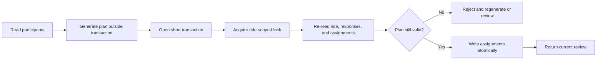

# Security, validation, and testing

RideSmart coordinates membership, pickup information, and driver/rider assignments. The engineering approach is to keep authority on the server, minimize data crossing service boundaries, and test the state transitions where stale or concurrent requests can cause operational harm.

This document describes controls at a public-safe level. It omits secrets, provider identifiers, internal URLs, and deployment-specific security configuration.

## Security boundaries

| Risk | Control |
| --- | --- |
| Unauthenticated access | Server-side session checks confirm the current account still exists |
| Cross-organization access | Organization membership and active status are checked before resource access |
| Privilege confusion | Platform role, organization role, ownership, and driver capability are separate concepts |
| Acting on another user's data | Self/resource relationship guards protect user-scoped operations |
| Malformed or ambiguous input | Zod schemas parse and narrow many request bodies before domain logic |
| Password disclosure | Passwords are stored through a memory-hard password hash; raw passwords are not persisted |
| Brute force and abuse | Database-backed limits protect abuse-prone application routes; the optimizer has its own process-local limit |
| Stale assignment plans | Plans are re-read and revalidated inside a transaction immediately before persistence |
| Concurrent assignment mutations | One transaction-scoped lock serializes safety-critical writes for a ride |
| Optimizer compromise or outage | The optimizer has no database authority; responses are validated and a fallback is available |
| Accidental sensitive logging in this case study | No source, configuration, real data, private URLs, credentials, or Git history are included |

## Validation layers

RideSmart uses four distinct validation layers:

1. **Shape validation** checks types, required fields, enumerated values, and request-specific relationships.
2. **Access validation** checks session, membership, role, driver approval, ride audience, and resource relationship.
3. **Domain validation** checks lifecycle status, capacity, response eligibility, duplicate riders, and whether an operation is still allowed.
4. **Commit-time validation** re-reads the decisive records inside the serialized transaction before writing.

The separation is deliberate. A request can be well-formed and authenticated but still be unsafe because its view of the ride is stale.

## Assignment integrity under concurrency

The core write path avoids holding a lock across slow work:

The same transaction boundary is reused for initial application, manual mutation, reassignment, automatic lifecycle writes, and finalization. Focused interleaving tests also run lock-disabled controls, which demonstrates that the tests can reproduce the race rather than merely pass the protected code.

## Test strategy

Automated coverage spans the web application, mobile application, API boundaries, accessibility behavior, and end-to-end workflows. It includes:

- web Jest tests for API and domain services, components, authorization, assignment planning, concurrency, lifecycle, and accessibility;
- mobile Jest tests for navigation, presentation state, API adapters, authentication, errors, maps, assignment flows, and accessibility contracts;
- Playwright journeys for browser-level administration, authentication, and ride lifecycle; and
- C++ executable checks and benchmarks for distance behavior, candidate validity, ranking, anti-clumping behavior, and sequential/parallel agreement.

The standard repository gate runs:

- web ESLint;
- web TypeScript;
- mobile TypeScript;
- web Jest; and
- mobile Jest.

A production build, write-enabled end-to-end run, hosted integration check, and device release pass are intentionally outside the default local gate because they can require provider access, credentials, or data mutation.

## Representative high-value tests

- Draft rides are hidden from non-admin members in list, search, count, and direct-detail paths.
- A withdrawn rider cannot remain seated if the response changes while a plan is being generated.
- A driver who stops offering seats cannot be committed from a stale plan.
- A reduced seat count cannot create an over-capacity assignment.
- Finalization cannot race with assignment mutation or ignore an unassigned responder.
- Applying the same selected plan is idempotent; applying a conflicting second plan is rejected.
- Pickup and no-show states produce distinct counts and presentation.
- Web and mobile clients present plain-language failures rather than raw server errors on covered surfaces.
- Accessibility tests cover landmarks, labels, validation associations, and core control semantics.

## Claim verification matrix

The matrix uses the technical snapshot defined in the root README.

| Résumé claim | Result | Public-safe wording |
| --- | --- | --- |
| Full-stack application built with Next.js and TypeScript | Confirmed | Next.js/TypeScript web and API, plus an Expo/TypeScript mobile app |
| 42-endpoint REST API | Outdated | 62 route modules and 84 HTTP method handlers in the snapshot |
| Typed request validation using Zod | Confirmed with scope | Zod validates request data across API and server boundaries; authorization and business checks remain separate |
| Role-based access control | Confirmed | Layered platform role, organization role, membership status, ownership, driver capability, and resource guards |
| PostgreSQL schema covering 15+ relational entities | Confirmed | 23 Prisma models backed by PostgreSQL in the snapshot |
| Standalone multithreaded C++ optimization service | Qualified | Developed a standalone C++ optimization service with sequential and multithreaded ranking paths, using partitioned worker ranges and mutex-protected rate limiting. |
| Use of `std::thread`, `std::mutex`, and RAII locking | Confirmed with scope | Threads rank large pools; mutex/RAII protects shared rate-limit state |
| Thread-safe best-solution selection with `std::mutex` | Inaccurate as previously worded | Best-plan ranking uses partitioned worker ranges and join-and-merge; the mutex does not protect winner selection |

## Current limitations and unverified areas

- Hosted authentication, email, push, maps, database recovery, and optimizer uptime require separate authorized live checks.
- Physical-device validation is not current for every recent mobile change, and iOS evidence is incomplete.
- The repository has no checked-in continuous-integration workflow enforcing the local gate.
- Mobile TypeScript and Jest are in the gate, but mobile ESLint is not currently configured.
- The C++ checks are executable assertions and benchmarks rather than a dedicated unit-test framework.
- Static and automated checks reduce risk but do not constitute a penetration test, privacy/legal review, or production load test.

These boundaries are kept explicit so the case study does not turn implementation evidence into unsupported production-readiness claims.
